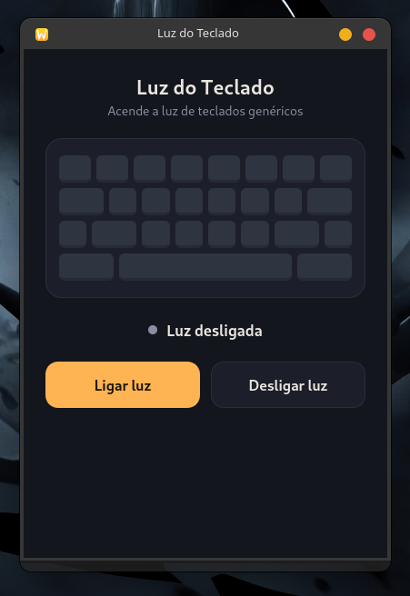

# 💡 Luz do Teclado

<p align="center">
  
</p>

Liga e desliga a luz de teclados genéricos no Linux, com dois cliques e sem digitar comandos.

Muitos teclados baratos têm a luz de fundo, mas ela **não acende sozinha** em alguns sistemas
(Linux Mint, Fedora, Ubuntu e outros). Este programa resolve isso.

## ⬇️ Baixar

Pegue o arquivo mais recente na página de
**[Releases](https://github.com/ezekielso/luz-teclado/releases/latest)**:

| Arquivo | Para quem |
|---|---|
| `.deb` | Linux Mint, Ubuntu, Debian. Instala e aparece no menu de aplicativos |
| `.rpm` | Fedora, openSUSE |
| `.AppImage` | Qualquer distro, sem instalar |

Instalar o `.deb`: `sudo apt install ./Luz*.deb` · Instalar o `.rpm`: `sudo dnf install ./Luz*.rpm`

## ▶️ Como usar

1. Dê permissão de execução ao arquivo: clique com o botão direito → *Propriedades* → *Permissões* → *Permitir executar como programa*. Ou pelo terminal:
   ```bash
   chmod +x Luz.do.Teclado_*.AppImage
   ```
2. Abra o programa.
3. Na **primeira vez** ele pede a senha de administrador. Isso acontece uma única vez.
4. Clique em **Ligar luz** ou **Desligar luz**.

> **Linux Mint / Ubuntu:** se o AppImage não abrir, instale o FUSE: `sudo apt install libfuse2`

## ✨ Recursos

- **Ligar ao iniciar o sistema:** a luz acende sozinha quando você entra no computador.
- **Ícone na bandeja:** ligue e desligue sem abrir a janela (ative em *Continuar na bandeja ao fechar*).
- **Linha de comando**, para atalhos e scripts:
  ```bash
  luz-teclado --on        # liga
  luz-teclado --off       # desliga
  luz-teclado --toggle    # alterna
  luz-teclado --status    # mostra o estado
  ```
  No AppImage use o nome do arquivo: `./Luz*.AppImage --on`
- **Copiar informações de suporte:** gera um texto com a sua distro e os LEDs do teclado, para colar nos comentários ou numa *issue* quando algo não funciona.
- **Remover permissão:** desfaz a regra de acesso ao LED, direto pela janela.

> **Ligar ao iniciar com AppImage:** não mova nem renomeie o arquivo depois de ativar a opção, ou desative e ative de novo.

## ❓ Como funciona

O Linux controla a luz do teclado por um arquivo do sistema, em
`/sys/class/leds/…::scrolllock/brightness`. Esse arquivo só aceita escrita do administrador,
e o comando manual seria:

```bash
sudo sh -c 'echo 1 > /sys/class/leds/input2::scrolllock/brightness'
```

O programa faz isso por você:

- **Acha o LED sozinho**, porque o número `inputN` muda de computador para computador.
- **Pede a senha uma vez** e cria a regra `/etc/udev/rules.d/99-luz-teclado.rules`, que libera
  a escrita **somente** nos LEDs de Scroll Lock. Depois disso não pede mais senha, nem após reiniciar.

Para desfazer a permissão, use o botão **Remover permissão** ou `sudo rm /etc/udev/rules.d/99-luz-teclado.rules`

## 🛠️ Problemas comuns

| Problema | Solução |
|---|---|
| "Nenhum teclado compatível" | O seu teclado talvez use outro nome de LED. Clique em **Copiar informações de suporte** e cole numa *issue* |
| Tela em branco (NVIDIA/Wayland) | Abra com `WEBKIT_DISABLE_DMABUF_RENDERER=1 ./arquivo.AppImage` |
| A luz apaga ao apertar Scroll Lock | Normal: o teclado usa essa tecla para a mesma luz. Clique em Ligar de novo |

## 🔧 Compilar você mesmo

Precisa de Node.js e Rust.

```bash
git clone https://github.com/ezekielso/luz-teclado
cd luz-teclado
npm install
NO_STRIP=true npm run tauri build -- --bundles appimage
```

Dependências no Fedora:
`sudo dnf install webkit2gtk4.1-devel openssl-devel librsvg2-devel libxdo-devel fuse fuse-libs`

Dependências no Mint/Ubuntu:
`sudo apt install libwebkit2gtk-4.1-dev build-essential libxdo-dev libssl-dev librsvg2-dev`

O AppImage fica em `src-tauri/target/release/bundle/appimage/`.

## 📄 Licença

MIT. Use, modifique e compartilhe à vontade.
